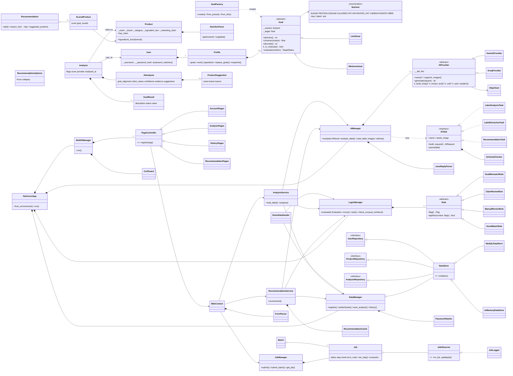

# NutriLenz Part 2 – Design notes

Material for the engineering report: UML, how each OOP concept is used, SOLID, design
patterns, new features, data flow and the exception-handling matrix.

## 1. UML class diagram

Paste into https://mermaid.live to export a PNG/SVG for the report.



## 2. OOP concepts – where and why

| Concept | Where (file) | Why it fits the domain |
|---|---|---|
| **Classes and objects** | 50+ classes; `NutriLenzApp` builds one object per manager and service (`nutrilenz/app.py`) | Every request runs through real objects: `User`, `Product`, `Analysis`, `Job`... |
| **Encapsulation** | `_private` attributes with read-only `@property` everywhere. Name-mangled `__password_hash` (`domain/user.py`) and `__api_key` (`ai/ai_provider.py`) | The password hash and API key can't be read from outside. `Profile.goals` returns a tuple so the list can't be changed without validation. |
| **Abstract classes** | `Goal`, `AIProvider`, `Rule`, `PageController`, `DataStore` | Each defines shared behaviour plus abstract steps. E.g. `Goal.evaluate()` is shared; `_is_met()` is abstract. |
| **Inheritance** | `LimitGoal`/`MinimumGoal` ← `Goal`; `GeminiProvider`/`GroqProvider` ← `AIProvider`; 5 rules ← `Rule`; dietary checks ← `DietaryCheck`; 4 page groups ← `PageController`; 2 stores ← `DataStore` | Subclasses only change what is different (e.g. Groq's request body). |
| **Interfaces** | `AITask`, `UserRepository`/`ProductRepository`/`AnalysisRepository`, `JobObserver` (pure ABCs, no state) | Contracts that several classes implement: three AI tasks, two stores, observers. |
| **Polymorphism** | `AIManager.run()` calls `provider.generate()` and `task.parse()` with no type checks. `LogicManager.evaluate()` loops `rule.applies()`. `goal.evaluate()` works for MAX and MIN goals. | New providers, tasks, rules and goals work without changing the calling code. |
| **Association** | `Analysis` → `Product`; services → managers (`AnalysisService` is given the managers, doesn't own them); `PageController` → `WebContext` | Objects work together but neither owns the other. A product exists without any analysis. |
| **Aggregation** | `Recommendation` o-- `ScoredProduct`/`Product`; `Batch` o-- `Job`; `DataManager` o-- `DataStore` (passed in from outside) | The parts exist on their own: products stay in the catalogue, jobs stay in the `JobManager`, the store is created outside the manager. |
| **Composition** | `User` *-- `Profile` *-- `Goal` (the profile creates its goals from specs); `Analysis` *-- `AIAnalysis`/`GoalResult`; `AIManager` *-- providers (made in `from_config`); `LogicManager` *-- rules; `WebIOManager` *-- page controllers; `DataManager` *-- `PasswordHasher` | The owner creates the parts and they are deleted with it. Deleting a user deletes the goals (DB `ON DELETE CASCADE`). |

## 3. SOLID evidence

**SRP – single responsibility.**
- `HttpClient` only sends requests.
- `GeminiProvider` only knows Gemini's format.
- `LabelAnalysisTask` only knows its prompt and schema.
- `JsonReplyParser` only parses.
- `SchemaChecker` only checks fields.
- `AIManager` only does retry/fallback.
- In the web layer, `FormParser` validates, controllers route, `CsrfGuard` protects forms, and templates display.
- The Part 1 `ai_manager.py` did all of the AI jobs in one module.

**OCP – open for extension, closed for change.**
- New nutrient: one line in the `Nutrient` enum. Forms, prompts, DB and validation pick it up automatically.
- New goal type: a `Goal` subclass plus one `GoalFactory._TYPES` entry.
- New flag rule: a `Rule` subclass. `test_new_rule_can_be_added_without_changing_logic_manager` proves this.
- New AI feature: a new `AITask`. Photo reading and recommendations were added without editing `AIManager.run()`.
- New AI provider: an `AIProvider` subclass.

**LSP – substitution.**
- `InMemoryDataStore` and `MySQLDataStore` pass the **same** contract tests (`tests/test_data.py` runs each test against both).
- `GeminiProvider` and `GroqProvider` are swapped in `test_providers_are_interchangeable`.
- Image support is a declared capability (`supports_images`) checked *before* calling. A provider is never handed a task it can't do, so no subclass breaks the base contract.

Also used:
- **ISP:** three small repository interfaces instead of one large one.
- **DIP:** services and `DataManager` depend on abstractions (`DataStore`, `AIProvider`), and concrete classes are chosen only in `NutriLenzApp`.

## 4. Design patterns

| Pattern | Where |
|---|---|
| Template Method | `AIProvider.generate()` (build → send → extract); `Goal.evaluate()` |
| Strategy | `Goal` subclasses, `Rule` subclasses, `AITask` implementations, `DataStore` back ends |
| Factory | `GoalFactory`, `AIManager.from_config()`, `NutriLenzApp._make_store()` |
| Repository | `UserRepository` / `ProductRepository` / `AnalysisRepository` |
| Facade | `AIManager`, `DataManager`, `NutriLenzApp` |
| Chain of responsibility (fallback) | `AIManager.run()` tries Gemini then Groq |
| Observer | `Job` notifies `JobObserver`s (`JobLogger`) on each step |
| Composition root / dependency injection | `NutriLenzApp.__init__` wires everything; tests inject fakes |

## 5. New and advanced features

| Feature | Problem it solves | How a user gets to it | Classes | Tests |
|---|---|---|---|---|
| **Multiple flexible goals** (8 nutrients, MAX/MIN) | Part 1 allowed one goal of 3 | Sign up / My goals | `Goal`, `LimitGoal`, `MinimumGoal`, `GoalFactory`, `Profile`, `GoalMismatchRule`, `GoodMatchRule` | `test_domain.py::TestGoals`, `test_logic.py::TestMultipleGoals` |
| **Label photo reader** (approved by lecturer) | Typing labels is slow | Analyse → Upload photos → check values → Analyse | `LabelExtractionTask`, `LabelImage`, `LabelReading`, `AnalysisService.read_label`, `AnalysisPages` | `test_ai.py::TestExtractionAndRecommendationTasks`, `test_web.py::test_photo_upload_then_review` |
| **Recommendations from fixed options** (tick one or more focuses and categories; several focuses are combined into one ranking) + **Singapore product suggestions** | "What should I buy instead?" without free-text prompts | Recommendations page; suggestions also on every analysis | `RecommendationOptions`, `LogicManager.rank`, `RecommendationTask`, `RecommendationService`, `RecommendationCache`, `ProductSuggestion` | `test_logic.py::TestRanking`, `test_services.py::TestRecommendationService`, `test_web.py::test_several_options_can_be_ticked` |
| **Dietary restrictions** (vegetarian, no-dairy vegetarian, vegan, halal-friendly, allergens) | Users need to know if a product fits their diet, not only their nutrient goals | Sign up / My goals; results on the analysis page | `DietaryCheck` and its subclasses, `DietaryCheckFactory`, `DietaryKeywords`, `DietaryReport`, `DietaryChecker`, `DietaryReviewRule`, `DietaryPresenter` | `test_dietary.py`, `test_dietary_followup.py` |
| Accounts with login | History and goals per person | Sign up / Log in | `User`, `PasswordHasher`, `LoginSession`, `CsrfGuard`, `AccountPages` | `test_web.py::TestAccounts`, `test_domain.py::TestPasswords` |
| History search/filter + dashboard summary | Find past results | History / Dashboard | `AnalysisRepository.list_analyses`, `HistoryPages` | `test_data.py::TestAnalyses`, `test_web.py::TestHistoryPages` |
| **Advanced: MySQL database (11.3)** | Data shared by accounts, full CRUD | automatic | `MySQLDataStore`, `schema.sql`, `DataManager` | MySQL contract tests (CI service) |
| **Advanced: GUI (11.2)** | Web pages instead of a terminal | browser | `WebIOManager`, controllers, templates | `test_web.py` |
| **Advanced: Threading (11.4)** | AI calls take 5–30 s and would freeze the page; several photos should not wait for each other | automatic (progress page) | `JobManager` (thread pool), `Job`, `Batch`, `JobObserver` | `test_services.py::TestJobs` (a barrier proves the jobs run at the same time) |
| **Advanced: CD (11.1)** | Every main build is deployable | GitHub Actions | `publish-image` job | runs only after all CI jobs pass |

Domain-rule change to document (needs lecturer approval):
- With several goals, GOAL_MISMATCH means **any** goal is missed.
- MANUAL_REVIEW includes **any** goal value missing from the label.
- GOOD_MATCH needs **all** goals met.
- With one goal, the results are identical to Part 1 (`test_single_goal_profile_behaves_like_part1`).
- The multi-condition CLAIM_REVIEW rule is unchanged.

## 6. Data flow

```
Photo(s) ─► FormParser ─► JobManager ─► AIManager(LabelExtractionTask) ─► review form (user edits)
Typed label ─► FormParser ─► LogicManager.check_unusual_numbers ─► confirm if needed
     ─► JobManager ─► AnalysisService:
          AIManager(LabelAnalysisTask)  ─ every record passes the AI
          ─► LogicManager.evaluate (rules, score)
          ─► DataManager.save_analysis (product reused, record + profile snapshot)
     ─► result page (polls /api/jobs/<id>) ─► History / Dashboard
Options ─► LogicManager.rank(catalogue) ─► AIManager(RecommendationTask) ─► cache ─► page
```

## 7. Exception-handling matrix

| Failure | Where detected | What happens | User sees |
|---|---|---|---|
| No API key | `AIManager.run` | `AIError(CONFIGURATION_ERROR)`, logged | "AI is not set up correctly" |
| Wrong key (401/403) | `HttpClient` | `AUTHENTICATION_ERROR`, skip retry, go to Groq | result from backup, or message |
| Wrong model (400/404) | `HttpClient` | `CONFIGURATION_ERROR`, go to backup | as above |
| Rate limit / server error | `HttpClient` | `API_UNAVAILABLE`, wait 1 s, retry, then backup | "busy, try later" if all fail |
| No internet / timeout (30 s) | `HttpClient` | `API_CONNECTION_ERROR`, retry, backup | "Could not reach the AI service" |
| Not JSON / wrong fields / bad values | `JsonReplyParser`, `AITask.parse` | `ValueError` → retry with the reason → backup | only if all attempts fail |
| AI picks a product not in the shortlist | `RecommendationTask.parse` | rejected and retried | never shown |
| Photo is not a label | `AnalysisService.read_label` | `UNREADABLE_IMAGE` | "try a clearer photo or type it in" |
| Wrong file type / too big | `LabelImage`, Flask 413 | rejected before any AI call | form error |
| Invalid form input | `FormParser` | `ValidationError` with every field | form re-shown with messages |
| Odd numbers / repeat product | `LogicManager`, `DataManager` | ask to confirm | warning box |
| MySQL down / starting | `MySQLDataStore._cursor` | `DB_UNAVAILABLE`, retried on next request | friendly 503 page |
| Damaged JSON in a row | `MySQLDataStore._json` | `CORRUPT_DATA`; lists skip the row and log it | rest of history still shows |
| Save fails after the AI step | `AnalysisService.analyse` | result kept, `saved=False` | result shown with "not saved" warning |
| Unexpected bug in a job | `Job.run` | `UNEXPECTED_ERROR`, stack trace logged | "Something went wrong" |
| Form posted without a CSRF token | `WebIOManager._before_request` | refused | "The form expired" |
| Another user's record or job | data queries + `JobManager.get_*` | treated as not found | 404 |
| Duplicate username | DB unique key / memory check | `DUPLICATE_USER` | "already taken" |
